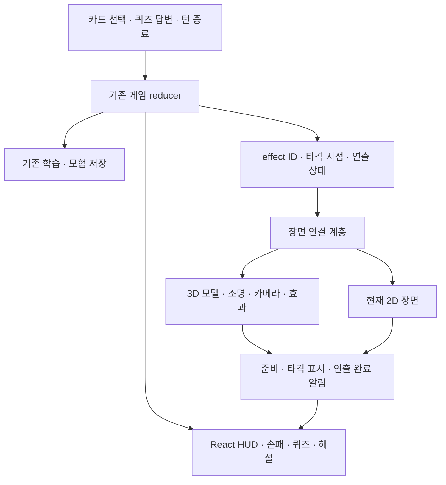

# S’word Master — 전체 UI 개편 및 3D 도입 계획

작성일: 2026-11-12. 상태: v0.7.0 구현·개발 환경 검증 완료. 실제 학교 컴퓨터·휴대폰 성능 검증은 남아 있다. 적용한 화면·모델·검증 결과는 [UI·3D 구현 기록](UI_3D_IMPLEMENTATION.md)을 참고한다. 아래의 현재 상태 표와 성능 목표는 계획 작성 당시의 기준이다.

사용자 목표는 게임 전체의 시각적 완성도를 높이고 3D를 포함하는 것이다. 구현 방향은 **읽기 쉬운 React UI 위에 실제 3D 던전·용사·몬스터를 결합하는 웹게임**으로 잡는다. 사선 고정 카메라를 사용하며, 먼저 전투 한 장면을 완성해 나머지 화면의 품질 기준으로 삼는다.

이 문서는 이후 UI·3D 작업의 기준이다. [2026-11-03 UI 개편 계획](UI_REDESIGN_PLAN.md)의 픽셀 아트 방향은 이전 기록으로 보존한다. 아래 수치와 작업 순서는 제안이며, 담당자·완료 날짜·모델 확보 방법은 미정이다.

## 1. 현재 상태와 목표

| 구분 | 현재 확인한 구현 | 개편 목표 |
| --- | --- | --- |
| 캐릭터 | 용사 4개 자세와 몬스터 12종의 2D 일러스트 | 같은 외형과 색을 공유하는 실제 3D 모델·행동 애니메이션 |
| 배경 | 픽셀 던전과 Phaser Canvas 장면 | 깊이·조명·그림자를 가진 모듈형 3D 던전 |
| UI | React, CSS, 카드·퀴즈·메뉴·단어장·복습 | 공통 디자인 규칙과 선명한 정보 우선순위 |
| 게임 진행 | 티어 → 입장 → 경로 → 전투 → 보상·휴식·대장간 → 보스·결과 | 기존 플레이 흐름에 일관된 UI와 3D 장면 적용 |
| 학습·저장 | 별도 reducer, 문제 데이터, 브라우저 저장 | 기존 단어 범위·정오답·해금·이어하기 호환 |
| 3D 자산 | 저장소에 GLB·glTF·FBX·Blender 모델 없음 | 용사 1명, 몬스터 12종, 던전·소품·효과 자산 확보 |

현재 일러스트는 3D 모델의 외형 참고와 2D 표시용으로 활용한다. 입체 캐릭터의 완성 기준은 회전 가능한 메시, 재질, 조명 반응과 실제 행동 애니메이션이다. 초기 블록 모형은 구조 검증용으로 구분한다.

## 2. 시각 방향과 공통 UI 규칙

시각 방향은 **붉은 망토의 용사가 탐험하는 정교한 판타지 던전**이다. 캐릭터는 형태가 분명한 입체 모델로, 배경은 캐릭터보다 대비와 세부 묘사를 낮게 만든다. 금속·석재·천의 재질과 따뜻한 횃불빛을 공유한다.

| 항목 | 초기 기준 |
| --- | --- |
| 색 | 바탕 `#151919`, 패널 `#202C27`, 본문 `#EEEBDD`, 강조 `#D3AE63` |
| 상태색 | 회복·성공은 비취색, 위험·오답은 적갈색. 아이콘과 문구를 함께 표시 |
| 글꼴 | 로고·영문 제목은 Cormorant, 문제·한글 본문은 읽기 쉬운 고딕체 |
| 글자 크기 | 본문 16px, 선택지 18–20px, 문제 단어 28–36px에서 시작. 기존 글자 확대 설정과 긴 보기로 조정 |
| 간격 | 4·8·12·16·24·32px 공통 간격 사용 |
| 재질 | 패널은 어두운 석재·금속, 보상·학습 기록에는 절제된 양피지 질감 |
| 테두리 | 큰 패널마다 중복 테두리를 두는 대신 명도·여백으로 영역 구분 |
| 선택 상태 | 기본·hover·키보드 초점·선택·비활성·로딩 상태를 공통 규칙으로 정의 |
| 움직임 | 버튼 반응 120–180ms, 패널 전환 180–280ms를 초기값으로 사용. 문제를 읽는 동안 카메라와 큰 입자는 안정적으로 유지 |

반복되는 버튼·패널·체력 막대·상태 배지·카드·선택지를 공통 컴포넌트로 정리한다. 문제와 선택지는 DOM으로 표시해 글자 확대, 키보드와 화면 읽기 도구를 지원한다. 본문 대비는 4.5:1 이상, 터치 대상은 최소 44×44px를 기준으로 확인한다.

## 3. 화면별 적용 범위

| 화면 | UI 개선 | 3D 적용 |
| --- | --- | --- |
| 시작 | 로고·새 모험·이어하기의 위계, 읽기 쉬운 메뉴 | 용사가 서 있는 던전 입구와 은은한 환경 움직임 |
| 티어 선택 | 선택 범위·잠금 조건·시작 동작을 명확히 구분 | 공통 던전 장면을 배경으로 재사용 |
| 던전 입장 | 로딩·건너뛰기·완료 표시 통일 | 용사가 문을 향해 걷고 들어가는 장면 |
| 경로 선택 | 현재 위치·갈 수 있는 길·장소 설명을 명확히 표시 | 기존 8층 경로 데이터를 작은 3D 방과 길로 표현 |
| 전투 | 체력·적 다음 행동·에너지·카드·퀴즈의 우선순위 정리 | 용사·몬스터·던전·기술 효과·접지 그림자 |
| 보상·덱·유물 | 카드 비교, 획득·선택·강화 상태를 공통 표현 | 배경 장면과 필요할 때의 유물 모형 |
| 휴식·대장간 | 현재 상태·예상 효과·비용·선택 결과를 선명하게 표시 | 모닥불·모루·조명 등 장소별 소품 |
| 승리·패배·학습 결과 | 게임 결과와 학습 기록을 구분하고 다음 행동 강조 | 승리 자세·쓰러짐·보스 처치 후의 장면 |
| 단어장·복습 | 검색·티어·목록·상세·풀이 흐름과 가독성 개선 | 공통 배경 사용, 읽는 동안 움직임 최소화 |
| 설정·안내창 | 분류·초점·선택 상태 통일, 그래픽 품질 설정 추가 | 그래픽 품질 변경을 현재 장면에 반영 |

### 전투의 정보 배치

PC에서는 체력·행동 예고를 위쪽에, 용사와 적을 가운데에, 에너지와 손패를 아래쪽에 둔다. 카드 선택 후 같은 하단 영역이 문제·선택지·해설로 전환된다. 배경을 어둡게 조절해 읽는 영역을 돋보이게 한다.

모바일에서는 카메라 거리를 조절해 두 캐릭터의 전신과 무기가 보이도록 한다. 긴 선택지는 줄바꿈하고 선택지와 확인 버튼은 화면 세로 스크롤로 접근할 수 있게 한다. 화면 폭 360px에서도 현재 행동에 필요한 정보를 확인할 수 있어야 한다.

## 4. 기술 구성

React + Vite + JavaScript + CSS를 유지하고, 3D 장면에 Three.js·React Three Fiber를 도입한다. Drei는 실제 필요한 로더·보조 기능에 한해 사용한다. 구현 시 React 19와 호환되는 버전을 확인하고 잠금 파일에 고정한다.

핵심 변경 위치:

| 위치 | 계획 |
| --- | --- |
| `src/game/engine.js`, `quiz.js`, `storage.js` | 전투 규칙·문제·저장 의미를 유지하고 기존 검사로 호환 확인 |
| `src/components/CombatScene.jsx` | 현재 props와 준비·진행·타격 콜백을 유지하는 장면 연결 계층으로 정리 |
| `src/game/attackTimeline.js`, `enemyAttackTimeline.js` | 타격 시간과 다단 공격 횟수 재사용. 3D 클립을 해당 타격 시점에 맞춤 |
| `src/game/three/` | 장면·캐릭터·로더·효과·품질 설정을 단계별 추가할 제안 경로 |
| `src/components/ui/`, `src/styles/` | 실제 반복되는 UI와 색·글자·간격 규칙을 정리할 제안 경로 |
| `src/components/useCardDeal.js` | 새 카드 배치에서도 덱에서 손패로 이동하는 연출과 완료 알림 유지 |
| `src/settings.js` | 그래픽 품질·2D/3D 선택값을 호환 가능한 기본값과 함께 추가 |
| `assets/models/`, `assets/textures/` | 준비한 모델과 텍스처를 저장할 제안 경로 |

현재 Phaser는 전투·입장·타이틀뿐 아니라 카드 드로우에도 사용된다. 각 장면을 교체한 뒤 참조와 동작을 확인하고 의존성 정리 여부를 결정한다.

이행 중에는 준비된 모델 목록을 기준으로 해당 적의 3D 장면을 선택하고, 모델이 준비되지 않은 적은 현재 2D 장면으로 표시한다. 실제 조우 목록과 확률은 유지한다. 개발용 미리보기에서는 저장 기록에 영향을 주지 않고 파수병 전투를 바로 확인할 수 있게 한다.

### 전투 연출과 저장의 연결 원칙

- 실제 피해·소비·정답 판정은 기존 reducer가 처리한다. `onImpact`는 타격 시점의 체력 표시를 갱신한다.
- 같은 effect ID는 한 번만 재생하고, 이어하기에서 지난 공격을 다시 실행하지 않는다.
- 프레임이 건너뛰어도 그 사이의 모든 타격 표시를 정확히 한 번 전달한다.
- 현재 치명타는 `Battle`에서 연출 후 `END_TURN`으로 패배를 확정한다. 이 흐름과 중복 입력 방지를 별도 회귀 검증한다.
- 장면 로딩 실패·연출 취소·움직임 끄기에서도 준비와 완료 상태가 정리되어 카드 입력이 계속 잠기지 않아야 한다.
- 실제 모험 기록에는 모델·카메라·애니메이션 객체를 저장하지 않는다.

## 5. 3D 자산 준비

첫 전투의 기준 자산은 **용사 1명 + 석문 파수병 1종 + 석조 전투방 1개**다. 용사의 붉은 망토·갈색 머리·올리브색 의상과 몬스터별 실루엣을 현재 일러스트와 연결한다.

제작 또는 사용 가능한 모델을 확보해 Blender 등에서 크기·방향·피벗·재질·리깅을 정리하고 GLB로 내보낸다. 코드로 만든 블록 모형으로 장면을 먼저 검증할 수 있지만, 모델과 행동이 완성되어야 최종 품질 기준을 통과한다. 유료 AI 도구 사용은 필수 조건으로 두지 않는다.

| 자산 묶음 | 필요한 모델·행동 |
| --- | --- |
| 용사 | 대기·걷기·공격·피격·방어·승리·쓰러짐, 검과 망토 |
| 인간형 적 | 석문 파수병·금간 집행자·황혼의 수문장. 공유 가능한 골격과 각 무기의 공격 동작 |
| 네 발 동물 | 이끼 발톱·그늘 사냥개. 몸체와 발의 접지를 확인하는 별도 동작 |
| 비행·정령 | 박쥐·불씨 망령·서리 등불·재의 감시자. 날갯짓·부유·불꽃·투명 재질 |
| 기타 적 | 비취 방울·별점 버섯·청동 딱정벌레. 변형·포자·다리 움직임 |
| 환경 | 석벽·바닥·기둥·문·횃불·책장·화로·모닥불·모루 |
| 기술 | 기존 카드 12종의 공격·방어·회복·강화·약화 효과와 강화형 표현 |

자산 목록에는 출처·사용 조건·크기·바닥 기준점·재질·애니메이션 이름·다운로드 크기를 기록한다. 모델 검사에서는 무기와 손의 결합, 발 미끄러짐, 망토 관통, 카메라에 의한 잘림을 확인한다. 처음에는 구운 조명과 단순한 망토 애니메이션으로 비용을 줄인다.

## 6. 단계별 실행 계획

각 단계는 아래 완료 기준을 충족한 뒤 다음 단계로 연결한다. 달력 일정은 첫 모델 확보와 실제 기기 성능 확인 후 산정한다.

| 순서 | 작업 | 산출물 | 완료 기준 |
| --- | --- | --- | --- |
| 1 | 전체 UI 디자인 기준과 전투 배치 | 공통 색·글자·상태 규칙, PC·모바일 전투 시안 | 긴 문제·선택지, 체력·행동 예고·손패를 읽고 조작 가능 |
| 2 | 3D 기반과 모델 검증 | 3D 개발용 미리보기, 로더·카메라·조명, 용사·파수병 모델 | 두 캐릭터와 무기가 보이고 대기·공격·피격 동작 및 2D 전환 작동 |
| 3 | 완성도 기준이 될 전투 한 장면 | 새 UI와 실제 단어·전투·저장을 연결한 플레이 | 카드 → 문제 → 정오답 → 기술 → 적 행동 → 승리·패배·이어하기까지 정상 진행 |
| 4 | 나머지 전투 콘텐츠 확장 | 몬스터 12종, 카드 12종·강화형, 배경 3종 | 모든 적의 패턴·다단 타격·방어·보스·연출 종료 확인 |
| 5 | 게임 전체 화면 확장 | 3D 경로·시작·입장·휴식·대장간, 보상·결과 및 공통 UI | 새 모험부터 8층 보스와 학습 결과까지 화면 흐름 연결. 단어장·복습·설정도 같은 규칙 적용 |
| 6 | 실제 기기에서 최적화·마감 | 품질 단계, 로딩·실패 복구, 검증 기록 | PC·모바일·학교 기기에서 가독성·입력·성능·기존 저장 호환 확인 |

### 1–3단계의 구체적인 작업

- [x] 현재 전투·지도·결과의 기준 캡처와 기존 저장 사례를 보관한다.
- [x] 버튼·패널·체력 막대·상태·카드·퀴즈의 공통 규칙을 정한다.
- [x] PC 1440×900, 작은 PC 1366×768, 모바일 390×844와 360px 폭의 전투 배치를 만든다.
- [x] Three.js 의존성과 모델 경로를 추가하고, 저장을 사용하지 않는 3D 미리보기를 만든다.
- [x] 바닥·벽·빛·사선 카메라·두 캐릭터의 크기를 맞춘다.
- [x] 용사와 파수병의 실제 모델·기본 행동을 연결한다.
- [x] 장면 연결 계층에서 현재 2D와 3D를 선택할 수 있게 한다.
- [x] `onReady`, `onBusy`, `onImpact`와 타격 시간을 연결한다.
- [x] 첫 전투에서는 기본 공격·방어·회복·다단 공격의 동작을 완성하고, 나머지 카드의 고유 효과는 4단계에서 확장한다.
- [x] 같은 문제를 정답·오답으로 각각 진행하고 단일·다단 공격과 치명타를 확인한다.
- [x] 로딩 중 닫기, 연출 중 리사이즈, 새로고침·이어하기, 움직임 줄이기·끄기를 검증한다.
- [x] 최종 모델과 새 UI를 적용한 PC·모바일 전투를 기록하고 나머지 화면에 확장한다.

## 7. 모바일 성능과 로딩

아래는 구현 시작 시의 예산이다. 실제 학교 기기와 휴대폰에서 측정한 뒤 조정하며, 아직 달성된 성능으로 표시하지 않는다.

| 항목 | 초기 목표 |
| --- | --- |
| 프레임 | PC 60fps, 모바일·낮은 품질 30fps |
| 첫 전투의 3D 자산 | 압축 전송 합계 12MB 이하를 목표로 측정 |
| 장면 복잡도 | 기본 품질의 활성 장면 약 10만 삼각형·150 draw call 이하부터 시작 |
| 품질 낮추기 | 렌더 해상도·그림자·입자 수·후처리를 함께 조정 |
| 로딩 | 첫 장면을 우선 로드하고 다음 적·배경만 예측해서 준비 |
| 비활성 화면 | 숨겨진 탭·읽기 전용 화면의 불필요한 렌더링을 정지 |

공유 재질·텍스처와 반복 소품을 재사용한다. 모델 압축·KTX2 텍스처는 실제 크기와 디코더 비용을 측정해 적용한다. 동시에 활성화되는 3D Canvas는 하나를 기본으로 하고, 모험 화면 뒤의 타이틀 장면은 정지 또는 해제한다. 화면 전환 시 텍스처·모델·이벤트의 수명도 관리한다.

그래픽 품질과 움직임 설정은 독립적으로 적용한다. WebGL2 지원 부족, 모델 로딩 실패 또는 그래픽 컨텍스트 손실 시 현재 2D 장면으로 이어갈 수 있게 한다. 게임 상태는 같은 reducer에서 이어받아 재시작이나 학습 기록 초기화가 필요하지 않게 한다.

## 8. 검증과 최종 완료 기준

현재 기준은 앞선 일러스트 적용 작업에서 확인한 자동 검사 67개와 PC·모바일 전투 기록이다. 새 구현 시 최신 검사 수와 결과를 다시 기록한다.

- 게임 규칙: 기존 문제·티어 범위·카드 소비·정오답·보상·유물·해금·저장 검사를 통과한다.
- 장면 연결: effect 중복, 타격 누락, 다단 공격, 치명타, 움직임 끄기, 로딩 취소와 실패 후 입력 잠금을 확인한다.
- 전체 흐름: 새 모험 → 입장 → 경로 → 전투 → 보상·서비스 → 보스 → 결과 → 복습·이어하기를 실제 UI로 확인한다.
- 표시: 모델과 무기의 잘림·지면 관통, 긴 뜻·줄바꿈, 최대 손패, 큰 글자 설정, 모달과 3D 장면의 겹침을 확인한다.
- 입력: 클릭·터치·방향키·숫자키·Enter·Escape·초점 복귀와 기존 두 번 누르기 확정을 확인한다.
- 복구·성능: 2D 전환, 반복 장면 진입·종료, 숨김 탭, 메모리 증가, 모바일 프레임과 다운로드 크기를 측정한다.
- 배포 파일: `npm test`, `npm run build`, 빌드 미리보기에서 모델·텍스처·디코더 경로를 확인한다.

최종 산출물은 같은 미술 방향을 공유하는 전체 UI, 실제 3D 캐릭터와 던전, 끝까지 이어지는 학습·전투 흐름, 품질 설정과 검증 기록이다. 첫 착수 범위는 **공통 UI 규칙·PC/모바일 전투 배치·용사와 파수병을 위한 3D 미리보기 구조**로 한다.
