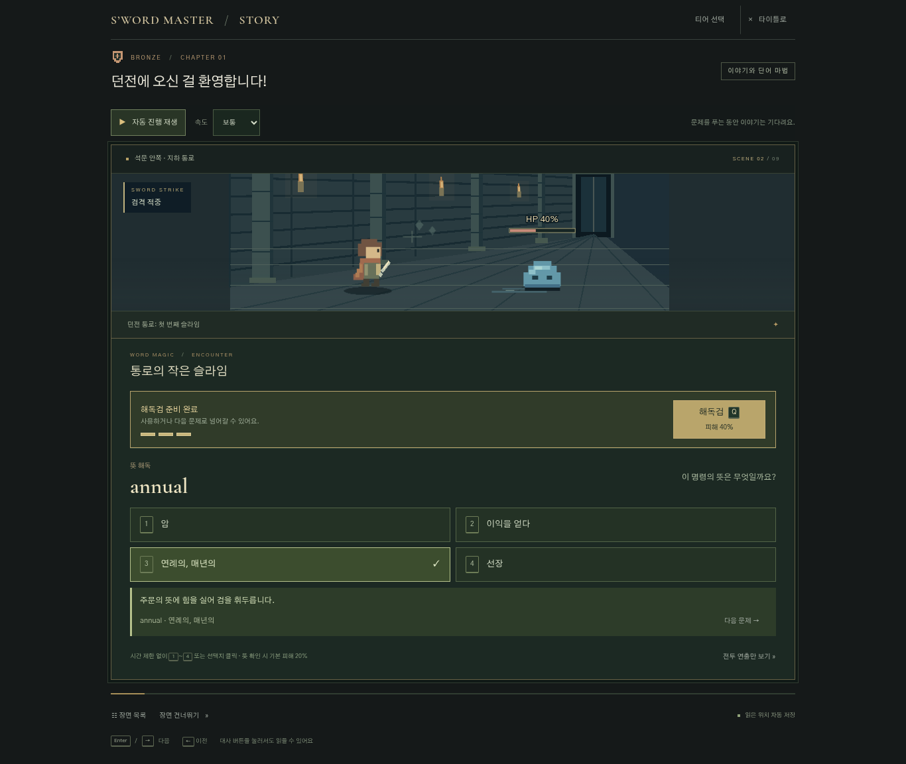
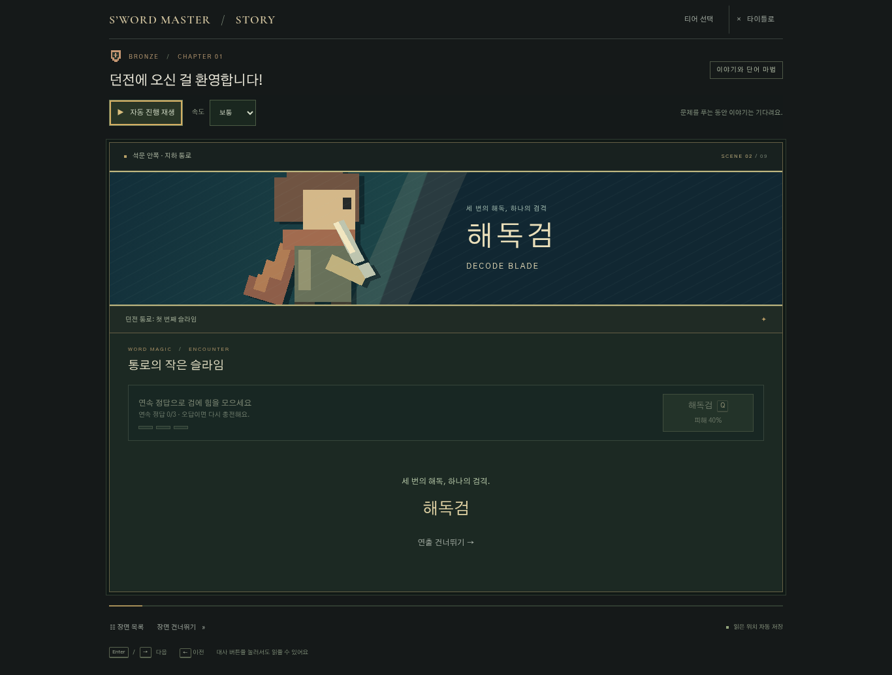
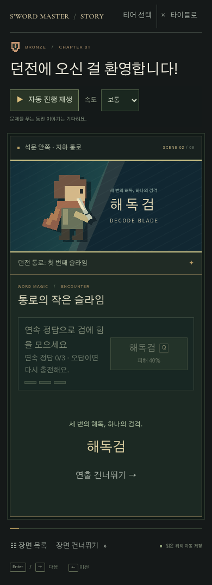

# S’word Master — 액티브 해독검과 몬스터 체력

## 조작과 전투

게임 시작 → 브론즈 → 장면 목록 → 전투·마법 퍼즐 바로가기 → 통로의 작은 슬라임에서 확인합니다.

- 슬라임 체력은 100%이며, 정오답 모두 답과 뜻을 확인하면 기본 피해 20%를 줍니다. 오답 피드백은 방어 동작과 정답 뜻을 보여 줍니다.
- 3연속 정답이면 해독검 한 번을 충전합니다. 충전 전 오답은 연속 기록을 초기화하고, 충전 후에는 오답에도 충전을 유지합니다. 중첩 충전은 없습니다.
- 충전된 버튼을 클릭·터치하거나 Q 키를 누르면 피해 40%의 해독검을 발동합니다. 물리 Q 키도 지원하며 입력 필드·한글 조합 중 입력·수정키 단축키·키 반복은 가로채지 않습니다.
- 충전되면 자동 다음 문제를 기다립니다. 스킬을 쓰거나 직접 다음 문제를 선택할 수 있습니다. 사용하면 충전을 소모하고 연속 기록은 0부터 다시 시작합니다.
- 체력 0%면 연출 완료 후 결과를 표시합니다. 3연속 정답과 해독검이면 3문항에 처치하며, 스킬 없이도 최대 5문항이면 끝납니다. 출제 풀은 기존 네 단어이고 다섯 번째는 첫 단어를 다시 출제합니다.
- 결과와 학습 이력은 실제 응답만 집계합니다. 먼저 처치해 풀지 않은 단어에는 기록을 만들지 않습니다.
- 모든 몬스터 위에 체력바와 `HP 100%` 형태의 숫자를 표시합니다. 다른 전투는 기존 응답 진행률을 남은 체력으로 환산합니다. 퍼즐의 문항 수·복원 막대는 유지합니다.

## 연출과 저장

해독검 컷인 800ms 뒤 기존 베기·복귀 1200ms가 이어져 전체 2000ms입니다. 일반 정답 공격과 오답 방어에는 컷인을 표시하지 않습니다. 단일 시계로 동작·효과음·체력 감소 표시를 맞추며, 발동 중 답변·다음 문제·중복 발동을 차단합니다. 장면 목록을 열거나 탭을 숨기면 재생을 멈춥니다. 명시적인 연출 건너뛰기는 피해를 취소하지 않으며, 움직임 줄이기는 기존 160ms의 짧은 연출을 사용합니다.

기존 학습 저장 키와 버전 1을 유지합니다. 슬라임 세션에 `combat.skillUses`로 사용 시점의 응답 수를 기록하고, 답변과 사용 이력에서 체력·연속 정답·충전을 함께 복원합니다. 사용 시점에 저장하므로 새로고침이나 연출 생략으로 피해가 중복되거나 충전이 돌아오지 않습니다. 과거 네 문항 완료 저장은 `combat.legacyComplete`로 완료 상태를 보존하고, 진행 중 저장은 응답에서 새 상태를 복원합니다. 재도전은 새 전투 상태를 즉시 저장하지만 누적 학습 이력을 보존합니다. 감상 연출은 전투 상태와 응답 이력에 영향을 주지 않습니다.

## 검증 — 2026-11-05

- Node.js 24.22.1에서 `npm test`, 상세 실행 `node --test --test-isolation=none`: 54개 통과.
- `npm run deploy:check`: 빌드와 Wrangler 업로드 없는 드라이런 통과. 이 환경의 쓰기 가능한 로그·설정 경로를 사용했습니다. 실제 배포는 실행하지 않았습니다.
- Chromium 1366×900: 타이틀 → 브론즈 → 장면 선택 → 3연속 정답 → Q 발동 → 처치 흐름 확인. 실제 연출 완료는 약 2.25초(브라우저 대기·화면 검사 시간 포함), 단위 시계 경계는 2000ms입니다.
- Vite 배포 빌드의 로컬 미리보기에서도 같은 진입·발동·저장 흐름과 장면 목록을 통한 컷씬 일시정지·재개를 확인했습니다.
- 클릭·Q 연타 차단, 준비 상태 자동 대기, 재도전 직후 새로고침, 오답 다섯 번 종료, 저장된 충전 복구와 오답 후 보관, 활성 스킬 생략·새로고침을 확인했습니다.
- 풍선·그림 인형·광고 괴물 분신·보스 체력 표시와 퍼즐 문항 표시를 확인했습니다.
- Chromium 모바일 390×844, 터치와 아주 큰 글자: 수동 발동, 2초 컷씬, 가로 넘침 없음, 움직임 끄기의 짧은 완료를 확인했습니다. 콘솔 오류는 없었습니다.

