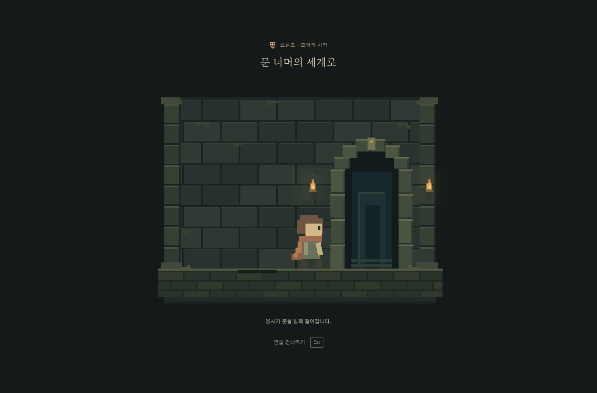
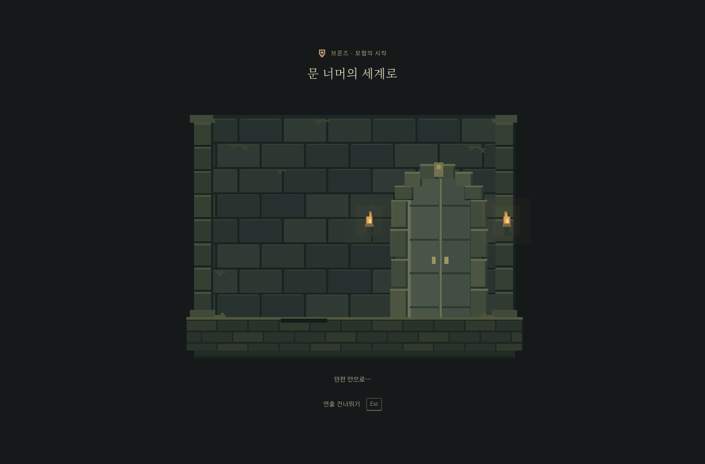
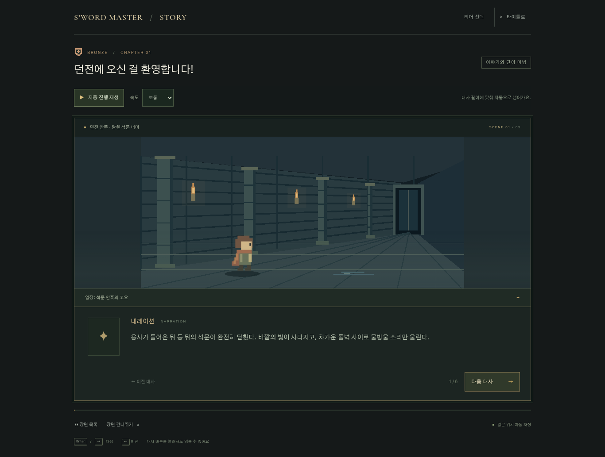

# S’word Master — 티어 선택 후 자동 던전 입장

게임 시작에서 제공되는 티어를 선택하면 대사 화면 전에 입장 연출을 자동 재생합니다. 현재 제공되는 이야기는 브론즈이며, 준비 중인 티어는 계속 비활성 상태입니다.

1. 석문이 양옆으로 열립니다.
2. 용사가 팔과 다리를 움직이며 문으로 걸어갑니다.
3. 용사가 문 안쪽으로 들어가며 멀어지고 사라집니다.
4. 용사가 완전히 들어간 뒤 양쪽 문이 닫힙니다.
5. 닫힌 문을 잠깐 보여 준 후 던전 안의 이야기로 이어집니다.

전체 길이는 3400ms입니다. 클릭·터치의 ‘연출 건너뛰기’와 Esc는 즉시 이야기로 연결합니다. 기기의 움직임 줄이기 또는 앱의 배경 움직임 줄이기·끄기에서는 걷기 대신 닫힌 문을 160ms 보여 줍니다. 탭을 숨기면 입장 시계를 멈춰 보지 않는 사이 이야기가 시작되지 않게 합니다.

## 도입 대사와 저장

기존 S01의 입장 전 고민·문 열기·밖에서 들어가겠다는 대사를 던전 안의 여섯 대사로 바꿨습니다. 첫 문장은 이미 석문이 닫힌 뒤의 상황이며, 용사는 안에서 지도와 마왕·보물의 소문을 떠올리고 앞으로 나아갑니다. 배경도 바깥의 문에서 지하 통로로 바꿨습니다. S01C는 이어진 통로를 탐색하다 슬라임을 만나는 기존 흐름을 유지합니다.

이야기 ID와 S01·S01C, 대사 수, 슬라임 전투 위치와 학습 저장은 유지합니다. 이전 S01 저장도 같은 대사 위치의 새 실내 장면으로 이어집니다. 이어보기와 오답 복습에서 전투로 이동할 때는 입장 연출을 다시 재생하지 않습니다. 새 시작에서만 연출하며, 입장이 끝나기 전에는 이야기 위치를 덮어쓰지 않습니다.

## 구현과 확인 — 2026-11-05

- `DungeonEntry`는 기존 Canvas 던전 배경과 SVG 용사·양쪽 석문을 합성합니다. 배경에서는 용사를 숨겨 중복 표시를 막습니다. 입장 컴포넌트와 시계는 필요할 때만 불러옵니다.
- 하나의 시계가 걷기·문·단계 설명과 자동 완료를 제어합니다. 입장 종료·건너뛰기·컴포넌트 해제 때 프레임과 이벤트를 정리하며, 중복 선택·완료가 이야기를 다시 시작하지 않게 합니다.
- 단위 테스트 64개 통과: 문이 닫히는 시점의 용사 부재, 닫힌 문 이후 완료, 숨김 일시정지·재개, 취소, 모션 줄이기와 기존 저장 호환을 포함합니다.
- Chromium 배포 빌드 PC 1366×900에서 티어 키보드 선택 → 자동 입장 → 문 닫힘 → 실내 대사를 확인했습니다. 건너뛰기 후에도 읽던 위치가 초기화되지 않고, 새로고침 후 이어보기는 입장을 반복하지 않습니다.
- Chromium 모바일 390×844·아주 큰 글자의 걷기와 터치 건너뛰기, 앱 움직임 줄이기·끄기와 기기 움직임 줄이기를 확인했습니다. 가로 넘침과 브라우저 콘솔 오류는 없었습니다.

