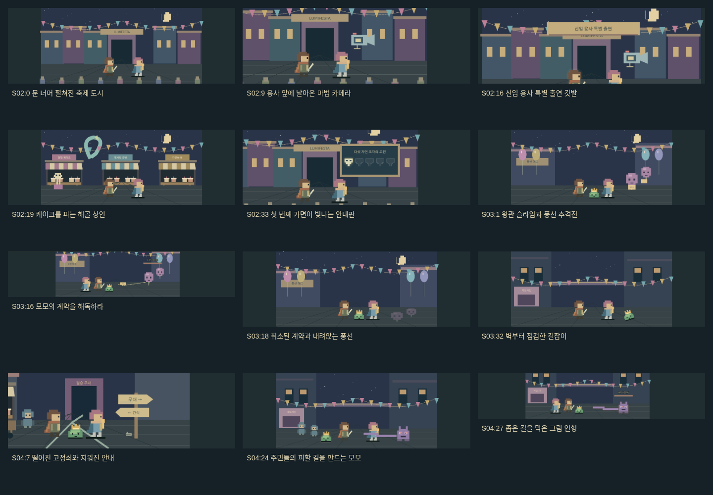
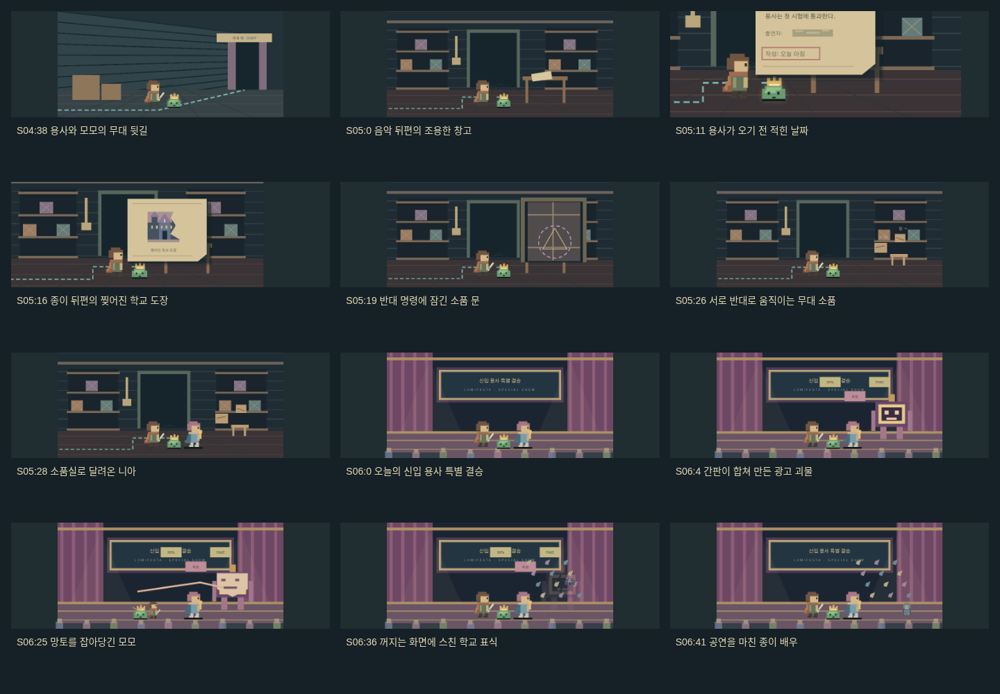
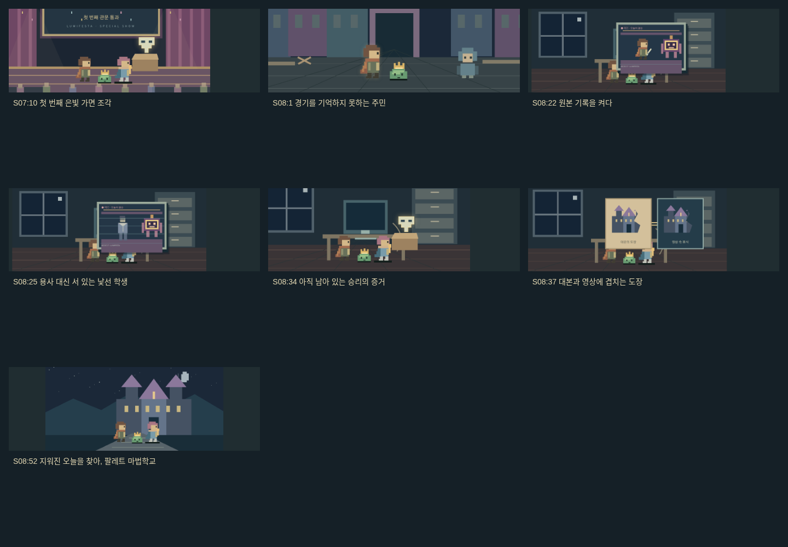

# S’word Master — 대사에 맞춘 루미페스타 장면

한 도시 배경을 반복하던 루미페스타 부분을 14개 장소와 81개 사건 구도로 나눴습니다. S02~S08의 284개 대사에는 사건 구도와 현재 화자에 맞는 화면이 연결됩니다. 내레이션은 사건·장소 또는 단서를 보여 주고, 대화는 화자 쪽으로 구도를 옮깁니다.

| 이야기 | 주요 장소와 사건 |
| --- | --- |
| 환영의 광장 | 축제 전경, 니아의 환영, 떠 있는 달, 마법 카메라, 재사용 깃발, 해골의 케이크 가게, 다섯 가면 안내판 |
| 모모의 합류 | 풍선 거리의 추격, 왕관에 묶인 계약, 내려앉은 풍선, 망토 뒤의 모모, 벽에 부딪힌 길잡이 |
| 무대로 가는 길 | 배달 수레와 갈림길, 떨어진 고정쇠, 복구된 표지판, 좁은 사진 골목, 주민 대피, 니아가 떠난 직원용 뒷길 |
| 무대 뒤 단서 | 대본 창고, 끊어진 안내선, 종이의 제목·날짜·지워진 이름·찢어진 도장, 봉인된 문, 반대 명령으로 움직이는 소품실, 니아의 재등장 |
| 결승 | 커튼과 전광판이 있는 무대, 합쳐지는 광고판, 분신·과장 광고, 카메라의 시선, 모모의 구조와 몸을 낮춘 용사, 갈라지는 보스와 종이 조각 |
| 시상식 | 줄에 매달려 내려온 상자, 은빛 가면 조각, 무대 아래로 이동한 일행, 꺼진 방송 카메라 |
| 지워진 오늘 | 한산한 광장과 문 닫는 가게, 주민들의 반응, 방송 확인실, 원본 화면·낯선 학생·바뀐 보관본, 남은 가면, 대본과 영상의 도장 비교, 학교의 실루엣 |

## 구현과 호환

`festivalDirection.js`에서 기존 대사 번호에 사건 구도·장소·등장인물·주요 대상을 연결합니다. `FestivalArt`는 화자 구도와 소품·표정·자세를 구성하고, `FestivalBackdrop`은 장소별 픽셀 배경을 그립니다. 장면 위아래의 장소·설명도 현재 사건에 맞춰 바뀝니다. 새 이미지 서비스나 네트워크 요청 없이 SVG로 그립니다.

모모는 S02에 나타나지 않습니다. 니아는 직원용 뒷길에서 떠난 뒤, 소품실로 달려오는 대사에서 다시 나타납니다. 엔딩에서 학생 모습은 25번째 대사부터 보이며 그 전 원본 화면에는 용사가 나옵니다. 단서는 각 대사의 공개 순서를 유지합니다.

그림 변경은 기존 이야기 ID·장면 ID·대사 번호·원문·전투 트리거·학습 저장을 바꾸지 않습니다. 던전 입구와 첫 슬라임전은 기존 컴포넌트를 사용합니다. 루미페스타 전투에서는 기존 채점·학습 기록·퍼즐 진행·몬스터 체력 표시를 연결합니다. 배경과 구도 데이터는 이야기 화면의 지연 로딩 묶음에 포함해 시작 화면에 모두 싣지 않습니다.

## 검증 — 2026-11-05

- 단위 테스트 59개: 대사 전체의 구도 연결, 단서 공개 순서, 동료 등장 시점, 전투 장소와 저장 위치 호환을 포함합니다.
- Vite 빌드와 Wrangler 배포 드라이런 통과. 실제 배포 명령은 실행하지 않았습니다.
- Chromium 1366×900에서 개발 화면과 배포 빌드 모두 284개 대사를 끝까지 이동했습니다. 81개 구도·14개 장소와 등장인물, 장소·사건 설명을 확인했고, 감상 전투가 학습 이력을 생성하지 않는 것도 확인했습니다.
- 배포 빌드에서 7개 전투·퍼즐의 실제 정답 선택, 검격·복원 효과, 체력·진행 표시와 새로고침 후 복구를 확인했습니다.
- Chromium 모바일 390×844·아주 큰 글자로 시장, 그림 인형 전투, 대본의 도장, 변조된 영상과 학교 풍경을 확인했습니다. 가로 넘침과 브라우저 콘솔 오류는 없었습니다.

