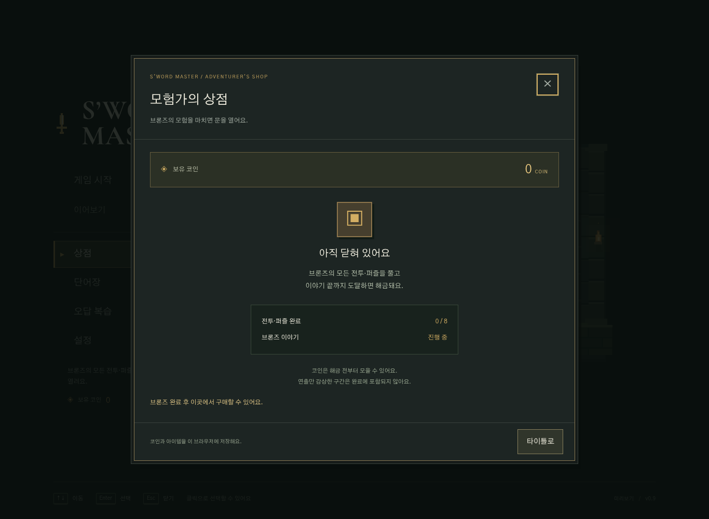
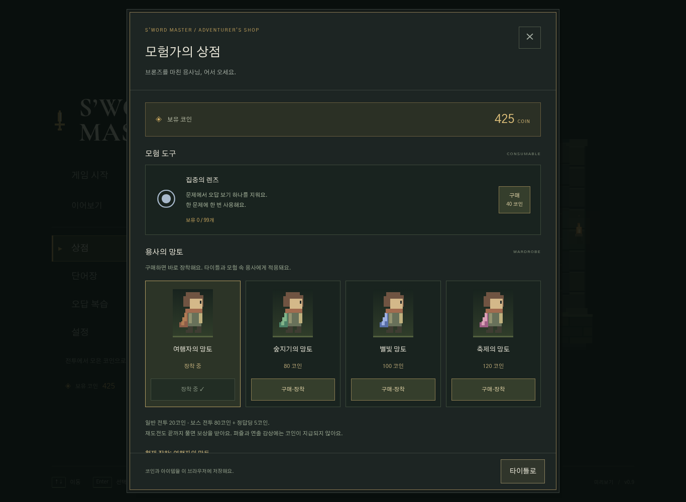
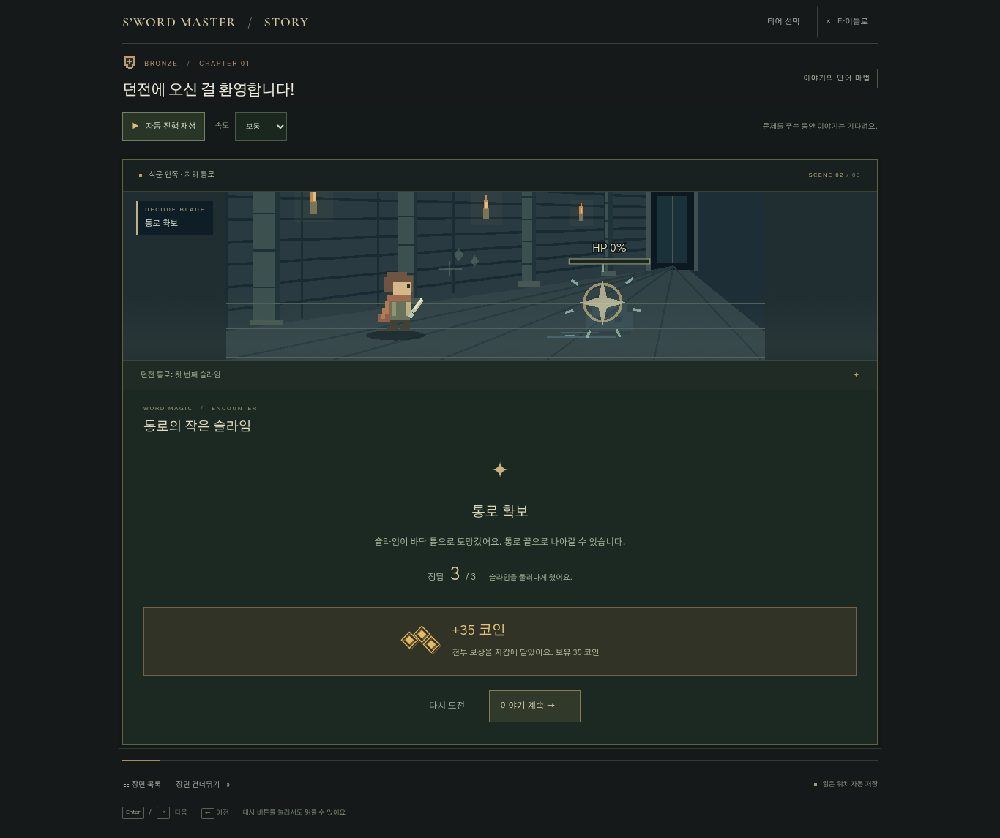
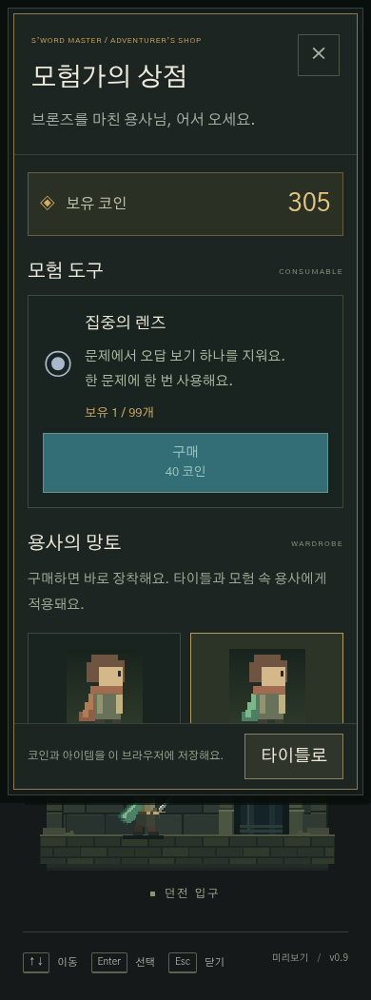

# 타이틀 상점과 브론즈 완료 해금

타이틀에서 ‘상점’을 선택한다. 완료 전에는 잠긴 상점과 조건을 보여 주며, 브론즈의 8개 전투·퍼즐을 직접 풀고 엔딩까지 도달하면 구매 기능이 열린다. 장면 건너뛰기나 연출 감상만으로는 전투·퍼즐 완료 기록을 만들지 않는다. 해금 후 재도전하거나 처음부터 다시 읽어도 해금은 유지한다. 학습 티어의 선택·범위에는 새로운 제한을 추가하지 않는다.

## 보상과 물품

| 항목 | 규칙 |
| --- | --- |
| 일반 전투 | 기본 20코인 + 실제 정답당 5코인 |
| 보스 전투(분신 포함) | 기본 80코인 + 실제 정답당 5코인 |
| 퍼즐·연출 감상 | 코인 없음. 직접 푼 퍼즐은 해금 조건에 포함 |
| 재도전 | 새 전투를 끝내면 다시 지급. 결과 재방문은 추가 지급 없음 |
| 집중의 렌즈 | 40코인, 최대 99개. 문제마다 오답 보기 하나를 제거 |
| 숲지기의 망토 | 80코인 |
| 별빛 망토 | 100코인 |
| 축제의 망토 | 120코인 |

기본 여행자의 망토는 무료로 보유한다. 망토를 구매하면 바로 장착하며, 보유한 망토의 재장착은 무료다. 외형은 타이틀 Canvas, 입장·전투·축제 장면의 용사 SVG와 초상에 적용한다. 전투 수치나 학습의 정답 판정은 변경하지 않는다.

슬라임을 정답 세 번과 해독검으로 처치하면 35코인, 스킬 없이 정답 다섯 번이면 45코인이다. 생략된 문제의 정답 보너스는 없다. 전투 결과에서 동전 드랍과 보유 잔액을 보여 주며, 움직임 줄이기·끄기에서는 동전 애니메이션을 생략한다.

렌즈는 정답을 제외한 보기 하나를 지운다. 제거한 보기의 숫자 키 입력도 차단한다. 새로고침해도 같은 문제의 제거 상태를 복원하며 추가 소모하지 않는다. 렌즈 사용은 응답·정답·연속 정답 기록을 만들지 않는다.

## 저장과 이전 기록

기존 `sword-master.bronze-learning.v1`에 `economy`를 추가한다. 잔액·인벤토리·망토·전투별 최초 완료 기록·엔딩 도달 여부를 보존한다. 세션의 `rewarded`와 잔액을 한 번의 저장으로 기록하고, 렌즈 차감과 세션의 `hints`도 함께 저장한다. 전투 재도전은 해당 세션만 초기화한다. 구매는 최신 상태를 기준으로 처리해 중복 망토 구매나 잔액 부족 구매를 차단한다.

이전 저장의 완료 전투에는 보상을 한 번 정산하고 학습 이력은 유지한다. 이전 4문항 슬라임 완료도 인정한다. 완료된 이야기 위치와 모든 전투·퍼즐 완료 기록이 있으면 바로 해금한다. 엔딩만 감상한 저장은 해금하지 않는다. 이미 해금한 뒤 세션을 재도전 중이어도 완료 이력을 유지한다.

저장소가 차단되면 앱을 계속 사용할 수 있으며 이번 접속에서만 유지된다는 안내를 보여 준다. 계정·서버 동기화는 추가하지 않으며 기존처럼 브라우저별 기록이다.

## 검증

- 단위 테스트 72개 통과. 보상·재도전·중복 정산·해금·기존 저장·구매·잔액·장착·렌즈·손상 저장에 대한 8개 테스트를 추가했다.
- `npm run build`, `npm run deploy:check` 통과. 업로드 없는 Wrangler 드라이런으로 확인했다.
- 실제 프로덕션 빌드에서 잠긴 상점 → 전투 코인 → 마지막 보스 정답 → 엔딩 → 상점 해금 → 구매·장착 → 새로고침 → 렌즈 사용을 확인했다. 콘솔 오류 없음.
- 실제 슬라임전에서 세 정답+Q는 35코인, 새로고침은 추가 지급 없음, 다섯 정답 재도전은 45코인 추가를 확인했다. 연출만 감상한 퍼즐은 완료·보상을 만들지 않았다.
- 이전 완료 저장은 425코인을 한 번만 정산하고 해금했다. 엔딩만 있는 저장은 잠긴 상태를 유지했다.
- PC 키보드·모바일 터치, 390×844 화면·최대 글자 크기·시스템 움직임 줄이기, 모달 닫기와 초점 복귀, 가로 넘침 없음, 저장소 차단 시 안내를 확인했다.

